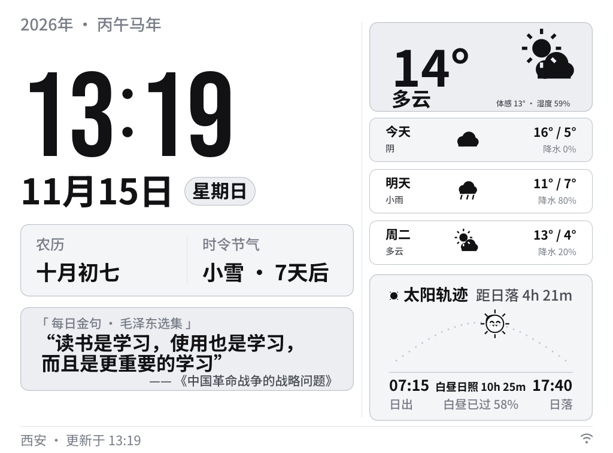

# kdash — Kindle 墨水屏日历与天气看板

kdash 面向已越狱并安装 KUAL 的 **Kindle Paperwhite 2（PW2，758×1024）**。Windows、Linux 或 macOS 主机负责天气、农历、排版和灰度图渲染；Kindle 只运行轻量 Shell 客户端，通过局域网拉取 PNG 并用 `eips` 显示。



## 支持矩阵

| 组件 | 支持平台 | 后台方式 |
| --- | --- | --- |
| 服务端 | Windows 11 x86-64（amd64） | 当前用户登录后启动的计划任务 |
| 服务端 | Linux x86-64 / ARM64 | systemd 系统服务 |
| 服务端 | macOS Apple Silicon（arm64） | 当前用户 LaunchAgent |
| 显示端 | Kindle PW2，固件 5.6.1.1 已验证 | KUAL + Shell 守护脚本 |

> Windows 计划任务不是 SCM 系统服务，未登录时不会运行。macOS LaunchAgent 也需要用户登录。其他 Kindle 型号和固件尚未验证，不在当前支持承诺内。

## 五分钟快速开始

以下命令使用官方仓库 `andycurise/kindle-kdash`；对应 Release 发布后即可直接执行。

### 1. 安装服务端

#### Windows 11 x64

在 PowerShell 中执行：

```powershell
& ([scriptblock]::Create((irm -Uri 'https://github.com/andycurise/kindle-kdash/releases/latest/download/install.ps1'))) -Repo 'andycurise/kindle-kdash'
```

安装到 `%LOCALAPPDATA%\kdash`，生成随机管理令牌，并注册当前用户登录计划任务。一般不需要管理员权限；添加 Windows 防火墙规则时可能需要单独提权。

#### Linux x86-64 / ARM64

```sh
curl -fsSL https://github.com/andycurise/kindle-kdash/releases/latest/download/install.sh | sudo bash -s -- --repo andycurise/kindle-kdash --non-interactive
```

安装专用低权限用户、`/etc/kdash/kdash.json`、`/var/lib/kdash` 和 systemd 服务。Linux 需要 `curl`、`tar`、CA 证书、正确系统时间及可用的 DNS。

#### macOS Apple Silicon

```sh
curl -fsSL https://github.com/andycurise/kindle-kdash/releases/latest/download/install.sh | bash -s -- --repo andycurise/kindle-kdash --non-interactive
```

程序安装到 `~/.local/bin/kdash`，配置位于 `~/Library/Application Support/kdash/kdash.json`，并注册当前用户 LaunchAgent。发布包目前不提供签名或公证承诺；Gatekeeper 处理方式见 [macOS 安装指南](docs/install/macos.md)。

### 2. 验证服务端

打开：

- Web 设置页：`http://127.0.0.1:8088/`
- 健康检查：`http://127.0.0.1:8088/api/status`
- Kindle 图片：`http://<主机局域网IP>:8088/screen.png`

安装器会生成随机 `settings_token` 并保留升级时的既有配置。远程保存设置、同步刷新和前光切换需要该令牌；不要把管理端口映射到公网，也不要在不信任的网络中开放。

### 3. 安装 Kindle PW2 客户端

1. 下载 `kdash-kindle-pw2.zip`，将包内的 `kdash/` 和 `extensions/` 解压到 Kindle USB 存储根目录。
2. 编辑 Kindle 根目录下的 `kdash/client.conf`：

   ```sh
   SERVER_URL="http://192.168.1.100:8088/screen.png"
   SETTINGS_TOKEN="与服务端 settings_token 相同"
   ```

   不使用 KUAL 远程前光切换时，可不在 Kindle 保存令牌。`REFRESH_SECONDS=60` 表示按下一分钟整点刷新，也可改成其他正整数秒数。
3. 安全弹出并拔掉 USB，在 KUAL 的“日历看板”中选择“安装/修复开机自启”或“启动日历看板”。
4. 若拉取失败，先检查主机防火墙、局域网 AP 隔离、服务端地址和令牌。升级不会主动覆盖已有 `client.conf`。

## 给 Agent 的一句话安装提示词

```text
请先识别当前系统和 CPU 架构，选择 andycurise/kindle-kdash 仓库 README 中对应的安装命令并固定到 v0.4.0；使用非交互模式，校验发布资产 SHA-256，保留已有配置，不执行 Kindle 部署，完成后请求 /api/status 并报告安装路径、服务状态和未验证事项。
```

固定版本的命令形式：

```sh
# Linux / macOS
curl -fsSL https://github.com/andycurise/kindle-kdash/releases/download/v0.4.0/install.sh | bash -s -- --repo andycurise/kindle-kdash --version v0.4.0 --non-interactive
```

```powershell
# Windows 11；Linux 系统服务安装请在命令前加 sudo
& ([scriptblock]::Create((irm -Uri 'https://github.com/andycurise/kindle-kdash/releases/download/v0.4.0/install.ps1'))) -Repo 'andycurise/kindle-kdash' -Version 'v0.4.0' -NonInteractive
```

安装器会下载 Release 资产并核对 `SHA256SUMS`。SHA-256 用于发现下载损坏或不一致，不能单独证明发布者身份；正式公开前还应按 [Release 文档](docs/releases.md) 配置签名和公证。

## 手动下载

| 文件 | 用途 |
| --- | --- |
| `kdash-windows-amd64.zip` | Windows 11 x64 服务端 |
| `kdash-linux-amd64.tar.gz` | Linux x86-64 服务端 |
| `kdash-linux-arm64.tar.gz` | Linux ARM64 服务端 |
| `kdash-darwin-arm64.tar.gz` | macOS Apple Silicon 服务端 |
| `kdash-kindle-pw2.zip` | Kindle PW2 Shell 客户端与 KUAL 扩展 |
| `SHA256SUMS` | 全部发布归档的 SHA-256 清单 |

各平台的手动安装、启动/停止、升级、回滚和卸载步骤见[文档索引](#文档索引)。

## 本地开发

要求 Go **1.27.4 或兼容的更新版本**、Git 和 POSIX Shell。Windows 开发可使用 WSL；PowerShell 安装脚本需要 Windows PowerShell 5.1 或更新版本。

```sh
# 测试并构建 Windows / Linux / macOS 服务端
./scripts/build.sh

# 生成全部服务端、Kindle 归档和 SHA256SUMS
./scripts/package.sh

# 不启动 HTTP、不请求真实天气，生成本地预览
go run ./cmd/kdash \
  -config configs/kdash.json.example \
  -preview preview_device.png \
  -preview-landscape preview_landscape.png
```

测试使用临时目录、`httptest` 和模拟刷新器，不访问真实天气或 Kindle。贡献代码前请阅读 [CONTRIBUTING.md](CONTRIBUTING.md)。

## 文档索引

- [Windows 11 安装](docs/install/windows.md)
- [Linux 安装](docs/install/linux.md)
- [macOS 安装](docs/install/macos.md)
- [Kindle PW2 安装](docs/install/kindle-pw2.md)
- [架构设计](docs/architecture.md)
- [Release 资产与校验](docs/releases.md)
- [发布维护指南](docs/development/releasing.md)
- [开源审查报告](docs/open-source-review.md)
- [安全说明](SECURITY.md)
- [更新记录](CHANGELOG.md)

## 开源协议

项目采用 [MIT License](LICENSE)。字体和 Go 依赖的版权与授权见 [THIRD_PARTY_NOTICES.md](THIRD_PARTY_NOTICES.md)。
